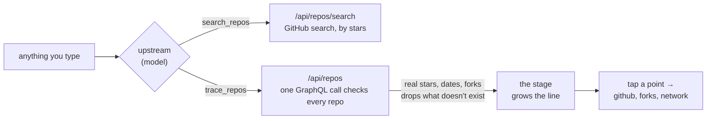

<div align="center">


<br>

**Type anything and watch the line of GitHub repositories it came from grow.**<br>
Every point is a real public repository — a fork, a port, a rewrite, a project built on or inspired by the one before — with its stars, its year and a link.

<br>

[](LICENSE)
[](#run-it)
[](src)
[](#how-it-works)
[](#fork-freeforks)

[**forks.wiki**](https://forks.wiki) · [**Run it**](#run-it) · [**How it works**](#how-it-works) · [**Setup**](SETUP.ru.md)

<br>


</div>

<br>

## Everything forks from something

`bitcoin/bitcoin` was forked into `litecoin-project/litecoin`, which was forked into `dogecoin/dogecoin`. `neovim/neovim` forked `vim/vim`. `ollama/ollama` is built on `ggml-org/llama.cpp`, which grew out of `ggml-org/ggml`. Open source is one big family tree — forks is a way to see a branch of it from a single question:

```
where did it come from?
```

Type a word, an idea, a product, `owner/name` or a GitHub link. Even things that aren't software: `doge` gets you the coins people built around it.

## The trace stage

While upstream looks, probes reach out from a seed and fall back. Then the line grows from the origin repository, point by point — each with its year, its stars and what changed — side branches sprout as it passes, the status line walks the points, and it arrives at the repository you asked about, ringed. Under it: the name, how many forks from which origin, the stars, and upstream's two or three lines. On a phone the same tree grows top → down, one row per repository, like `git log --graph`.

**Tap any point** for its card: description, language, stars, since when, how it came from its parent (*a fork of …*, *a rewrite of …*, *built on …*), and links — **open on github**, its **forks**, the **network graph**, the homepage — then *trace from here* or *what did it become?*.

<div align="center">

</div>

## How it works



1. **upstream proposes the line.** The model searches GitHub for the real names, then calls `trace_repos` with 3–9 repositories from the origin to your answer and how each came from the one before.
2. **GitHub checks it.** `netlify/functions/repos.mjs` looks every repository up in one GraphQL call. Repos that don't exist are dropped and their children re-hung; renamed ones get their current name; a link GitHub itself records as a fork is marked as one; and if the origin is a fork, its real parent is added above it.
3. **The page grows it.** Stars, years and links on every point are GitHub's, never the model's.

Without a model, forks falls back to GitHub alone: the most-starred match and the forks GitHub records above it. Details: [docs/UPSTREAM.md](docs/UPSTREAM.md).

| Where it runs | Model | GitHub check |
|---|---|---|
| [forks.wiki](https://forks.wiki) / your Netlify deploy | any OpenAI-compatible endpoint via [`ask.mjs`](netlify/functions/ask.mjs) (`FORKS_LLM_KEY`) | yes, with `GITHUB_TOKEN` |
| As a Claude artifact | Claude, through the page's `sample` capability | no — names as the model gave them |
| Local dev | same functions, run by `npm start` | with `GITHUB_TOKEN` |

The model key and the GitHub token never reach the browser. `/api/ask` sends its own brief and tool list and accepts only chat turns; `/api/repos` validates names, caches for a day and rate-limits per IP.

## $FORK · /freeforks

The button under the input — **get +5,000 $FORK** — or `/freeforks` starts the trials in the chat: sign in with X, then four small forks of your own, one at a time.

| Trial | Opens | Pending $FORK |
|---|---|---|
| follow | `x.com/intent/follow?screen_name=…` | 1,500 |
| like | `x.com/intent/like?tweet_id=…` | 1,000 |
| repost | `x.com/intent/retweet?tweet_id=…` | 1,250 |
| comment | the post itself | 1,250 |

**GO** opens the link and starts the server's clock; five seconds later the claim counts — nothing is checked against X. Then a Solana wallet and the summary. The account and post live in `src/config.js`; amounts live in the database, never in the browser. Allocations are **pending**, never a balance.

## Run it

```bash
git clone https://github.com/forkwiki/fork.git
cd fork
npm start                                   # http://127.0.0.1:5173
GITHUB_TOKEN=… FORKS_LLM_KEY=… npm start    # with GitHub and upstream
```

`npm start` runs every function in `netlify/functions` the way Netlify routes them. Without the X / Supabase variables, `/freeforks` runs as a labelled demo.

**Deploy:** import the repo into Netlify; `netlify.toml` builds upstream's brief and ships the functions. Every variable and every step is in **[SETUP.ru.md](SETUP.ru.md)**; `GET /api/health` lists whatever is still missing.

| File | What it does |
|---|---|
| `src/brain.js` | Routing, upstream's rules, `search_repos` / `trace_repos`, the model backends, the GitHub-only fallback. |
| `src/stage.js` | The trace stage: probes, the growing line, side branches, status, focus ring. |
| `src/app.js` | The page: input, messages, the result under each stage, repository cards, full view, theme, $FORK button. |
| `src/quest.js`, `src/config.js` | `/freeforks` and every public setting. |
| `netlify/functions/repos.mjs` | GitHub: GraphQL lookup of up to 12 repos, search; token server-side. |
| `netlify/functions/ask.mjs` | The model proxy; brief and tools from `netlify/lib/upstream.mjs`. |
| `netlify/functions/{auth-start,auth-callback,api}.mjs`, `supabase/` | Sign in with X and the trials. |

## Design

One question in **Instrument Serif**, everything else in **JetBrains Mono**. Near-black with a single mint accent that only ever means *the line*. The logo, the underline under the question, the background canopy and every tree are the same gesture — **a line that forks.** See [docs/DESIGN_SYSTEM.md](docs/DESIGN_SYSTEM.md) and [docs/MOTION_SYSTEM.md](docs/MOTION_SYSTEM.md).

## Roadmap

- [x] The trace stage
- [x] Every point a real GitHub repository, checked
- [x] $FORK trials with sign-in with X
- [ ] Shareable trace links (`forks.wiki/?q=…`)
- [ ] Cache traced lines so the same question grows the same tree
- [ ] Streaming for the endpoint backend

## License

[MIT](LICENSE). Repository data comes from GitHub's API; forks links to every repository it shows.

<div align="center"><br><br><sub><i>everything forks from something.</i></sub></div>
