<div align="center">


<br>

**Type anything — a meme, a phrase, a ticker, a link — and see where it came from.**<br>
One question, one answer, one family tree. 81 lineages are hand-sourced; everything else upstream traces live, fork by fork, up to the thing you asked about.

<br>

[](LICENSE)
[](#run-it-in-30-seconds)
[](src)
[](#data-you-can-trust)
[](#how-upstream-answers)
[](#fork-freeforks)
[](CONTRIBUTING.md)

[**forks.wiki**](https://forks.wiki) · [**Run it**](#run-it-in-30-seconds) · [**How it works**](#how-it-works) · [**Add a lineage**](CONTRIBUTING.md)

<br>

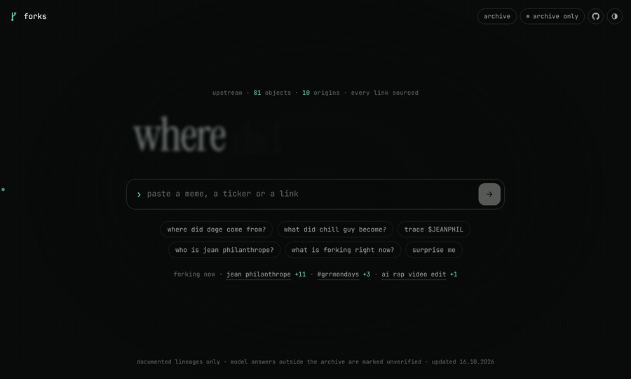

<sub>Type a question. The tree behind the page leans toward you while you type, sends signals while it thinks, and lights the path when it answers.</sub>

</div>

<br>

## Everything comes from something

A shiba photo on a blog becomes **Doge**, Doge becomes **Dogecoin**, Dogecoin becomes Twitter's logo for a week and the name of a government department. A drawing of a laid-back dog becomes **Chill Guy**, then a slideshow format, a plush toy, a song — and a token the artist never agreed to. An AI "Frenchman" shadowboxing in Paris gets a coin, a rival, copycats and debunk threads **in under two weeks**.

forks keeps that family tree, and gives it one door: **a single question.**

```
where did it come from?
```

No dashboard, no filters, no graph to learn. You ask, **upstream** answers — in two to five dry lines, with the lineage drawn underneath and the sources one tap away.

<table>
<tr>
<td width="50%">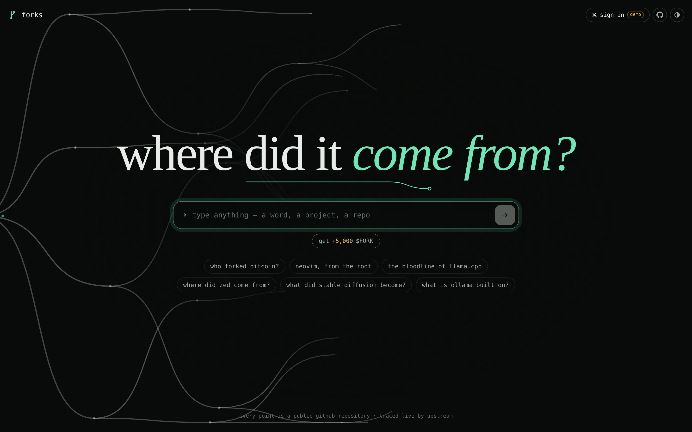</td>
<td width="50%" valign="top">

### One question
The whole homepage is one line of type and one input. Paste a name, a `$TICKER`, an `@handle` or a link. Six starter questions and what's forking right now sit underneath — that's it.

Behind the page, **one canopy forks forever** from an origin off the left edge. It is the only metaphor on the site.

</td>
</tr>
<tr>
<td width="50%" valign="top">

### An answer, not a page
The reply names the parent, the origin and how sure the archive is — `1 of 1 link verified · path confidence 95%` — then draws the whole family with **your object's line lit in mint.** Tap any node to ask about it next.

</td>
<td width="50%">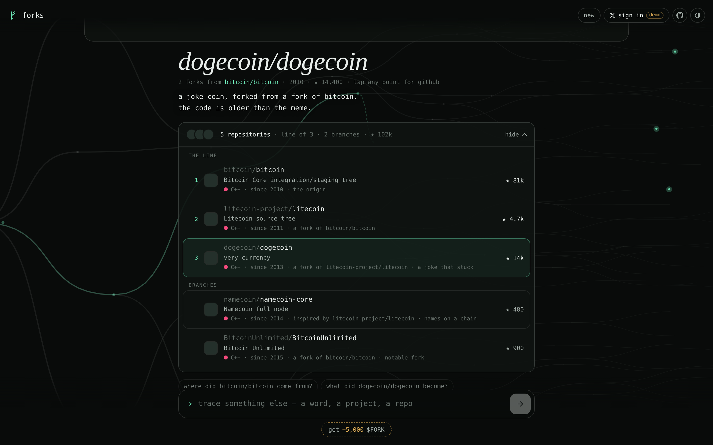</td>
</tr>
<tr>
<td width="50%">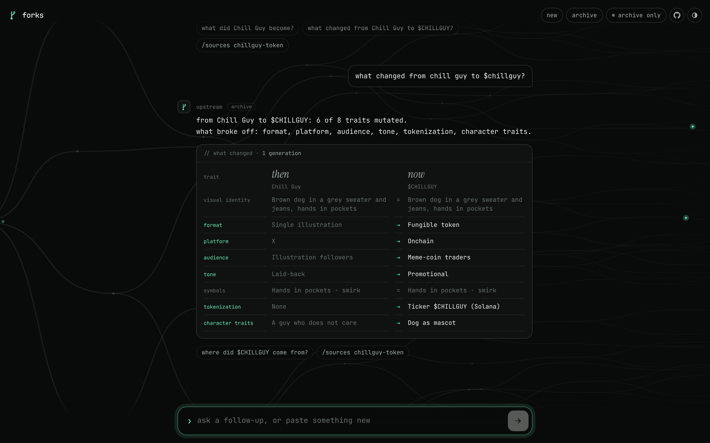</td>
<td width="50%" valign="top">

### What changed?
Ask *"what changed from chill guy to $chillguy?"* and you get **then → now** across eight traits: visual identity, format, platform, audience, tone, symbols, tokenization, character. Mutated traits glow; survivors stay grey.

</td>
</tr>
<tr>
<td width="50%" valign="top">

### Open the whole tree
`open ↗` on any card shows the full family, every node dated and typed. **Solid** = verified, **dashed** = likely, **dotted** = disputed. `Esc` closes it.

</td>
<td width="50%">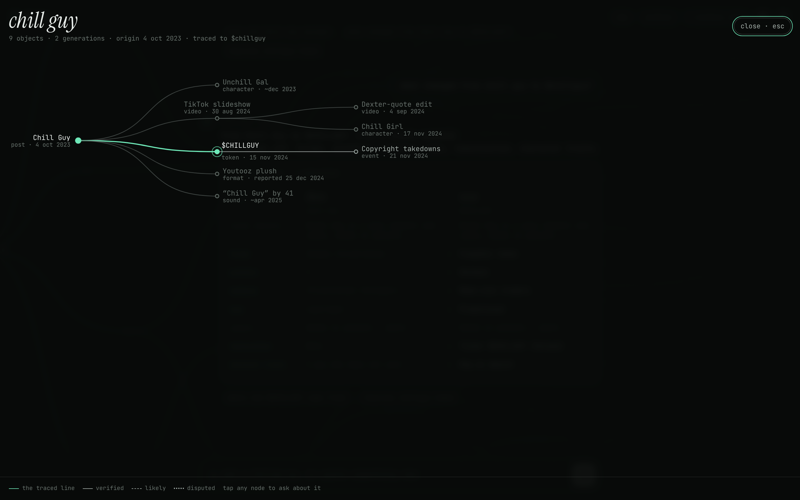</td>
</tr>
</table>

## How upstream answers

forks has two brains: the archive, which only says what it can source, and the model, which traces everything else.

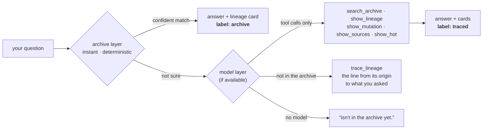

1. **The archive layer** runs in the browser on every question. Intent detection (origin, became, changed, sources, hot, random — English and Russian), fuzzy and transliterated search, tickers, handles and URLs. If it's confident, it answers instantly and the model is never called.
2. **The model layer** takes everything else — a word, a phrase, a whole sentence. It has **no copy of the archive**, just tools. It calls `search_archive` first; archive objects are always shown from sourced data, never retold.
3. **Outside the archive**, the model traces the line itself with `trace_lineage`: origin → each fork, with a year and what changed → the thing you asked about. The page draws it like any other lineage, your line in mint, every node tappable. The reply is tagged `traced` instead of `archive`, and it never comes with invented links.

<div align="center">
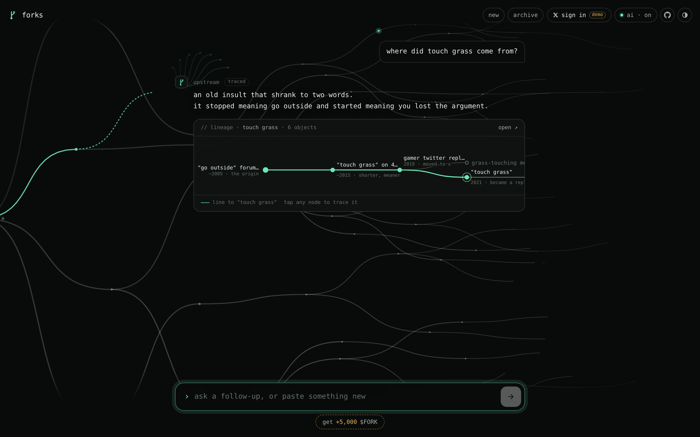
</div>

Where the model comes from:

| Where it runs | Model | Setup |
|---|---|---|
| As a Claude artifact | Claude, through the page's `sample` capability | none |
| [forks.wiki](https://forks.wiki) / your Netlify deploy | any OpenAI-compatible endpoint via [`netlify/functions/ask.mjs`](netlify/functions/ask.mjs) | set `FORKS_LLM_KEY` (+ optional `FORKS_LLM_URL`, `FORKS_LLM_MODEL`) |
| Local dev | same function, run by `npm start` | `FORKS_LLM_KEY=… npm start` |
| GitHub Pages / no key | none — the pill in the corner says **archive only** | nothing; everything above still works |

The key never reaches the browser. The function sends its own system brief and tool list (built from `brain.js`), accepts only chat turns, caps message size, rate-limits per IP and only forwards same-origin requests. Still set a monthly spend limit on the key at your provider: the per-IP limit lives in memory and resets with each function instance.

<div align="center">
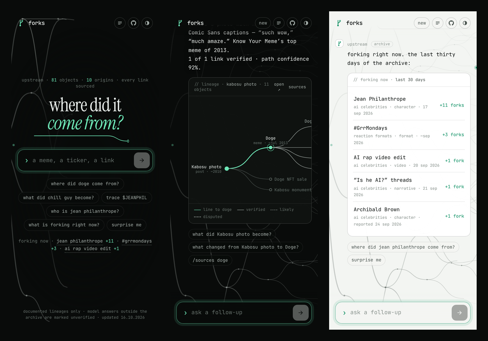
<br><sub>Built for a phone first: the input docks to the bottom, cards scroll sideways, light and dark follow the system.</sub>
</div>

## The archive at a glance

<div align="center">
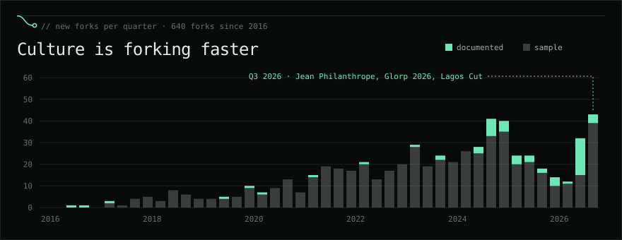
<br><br>
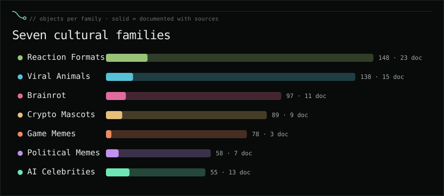
<br><br>
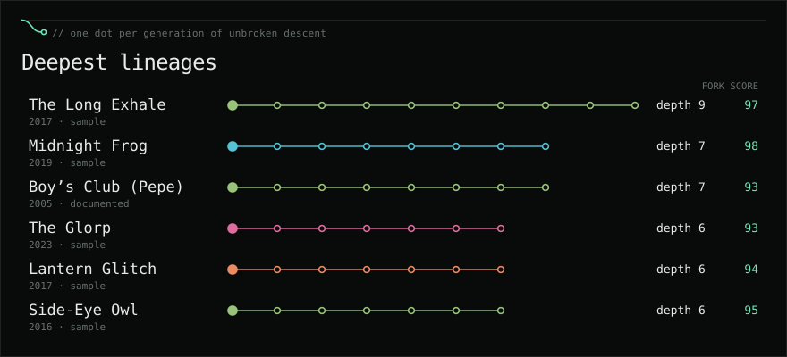
<br><br>
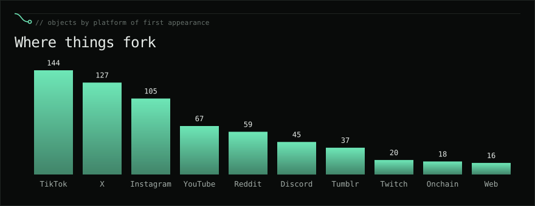
<br><sub>Generated from <code>src/data.js</code> with <code>npm run charts</code>.</sub>
</div>

### A lineage, as a git graph

forks is git for culture. One documented lineage, branch by branch:

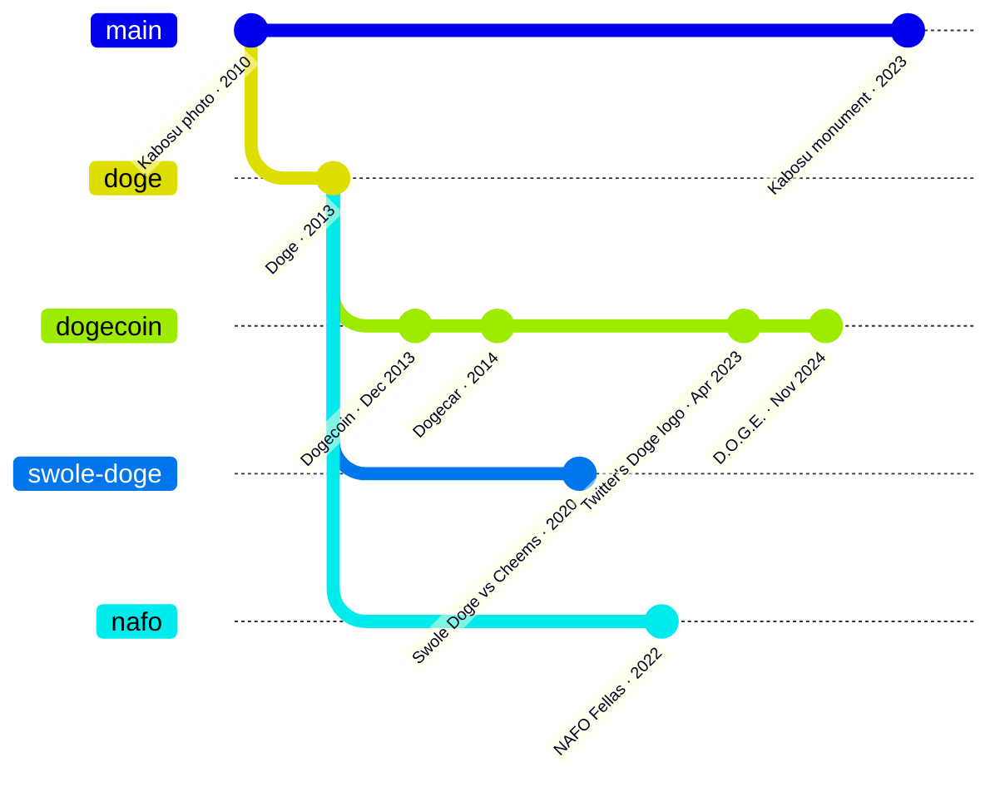

## Run it in 30 seconds

No framework, no bundler, no dependencies. One HTML file and four scripts.

```bash
git clone https://github.com/forkwiki/fork.git
cd fork
npm start                          # → http://127.0.0.1:5173  (archive only, /freeforks in demo mode)
FORKS_LLM_KEY=sk-… npm start       # same, with upstream's model layer
```

`npm start` runs every function in `netlify/functions` the way Netlify routes them. With the X and Supabase variables set (see [SETUP.ru.md](SETUP.ru.md)) the sign-in and the trials work locally too; without them `/freeforks` runs as a **demo** on localStorage, labelled as such.

### Deploy your own

- **Netlify** — import the repo. `netlify.toml` validates the data, builds the archive and ships the functions (`/api/ask`, sign-in with X, the trials). Environment variables and the step-by-step setup of X, Supabase and Netlify are in **[SETUP.ru.md](SETUP.ru.md)**; `GET /api/health` lists whatever is still missing.
- **GitHub Pages** — push to `main`; the included workflow publishes the site (archive only). In *Settings → Pages* set the source to **GitHub Actions**.
- **Anything static** — Vercel, Cloudflare Pages, `npx serve .`. Without the function the site simply stays archive-only.

## How it works

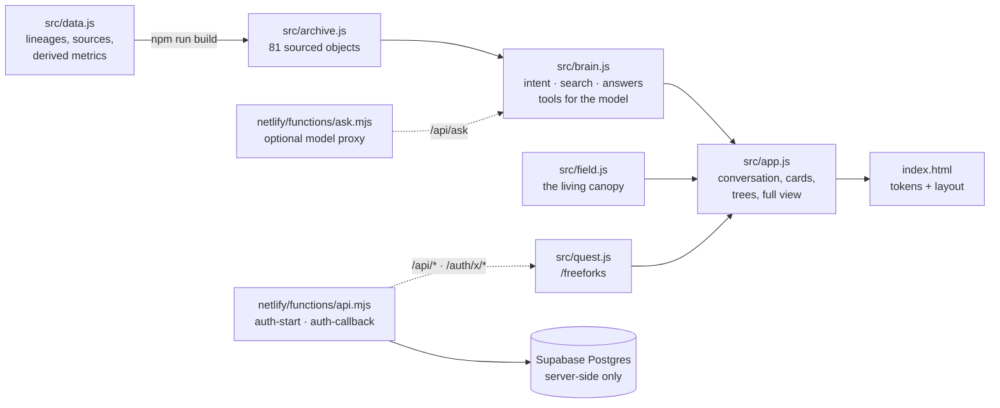

| File | What it does |
|---|---|
| `src/data.js` | The source of truth. Documented lineages with sources, labelled sample lineages, and everything derived: depth, descendants, fork score, status, momentum, path confidence. |
| `src/archive.js` | Generated by `npm run build`: only the documented, sourced objects — what the site ships. |
| `src/brain.js` | upstream. Intent detection, fuzzy + transliterated search, archive answers, the model's tool set and system rules, and the two model backends (Claude `sample` / OpenAI-compatible endpoint). |
| `src/app.js` | The single screen: hero → chat, typed replies, lineage / traced / mutation / sources / hot / archive cards, SVG tree layout, full-tree overlay, theme, the $FORK button and header pill. |
| `src/quest.js` | `/freeforks`: sign-in card, the four trials one by one, wallet, summary. Live backend (`/api/*`) or a labelled demo on localStorage where the functions don't exist. |
| `src/config.js` | Every public setting in one place — ticker, CA, the X account and post for the trials, links. Read by the page and imported by the functions. |
| `src/field.js` | The background canopy on canvas: idle growth, *listening* (leans toward the input as you type), *thinking* (signals run from the origin), the lit path on answer, sprouts where you tap. Respects `prefers-reduced-motion`. |
| `netlify/functions/ask.mjs` | Optional. Keeps the key server-side, sends upstream's own prompt and tools (`netlify/lib/upstream.mjs`, generated), caps payloads, rate-limits, forwards to any OpenAI-compatible chat endpoint. |
| `netlify/functions/auth-start.mjs`, `auth-callback.mjs` | Sign in with X: OAuth 2.0 + PKCE, read-only scopes, the X token is revoked right after reading the profile; session in a signed HttpOnly cookie. |
| `netlify/functions/api.mjs` | `/api/health`, `/api/me`, `/api/logout`, `/api/task/open`, `/api/task/claim`, `/api/wallet`. Talks to Supabase over REST with the service key — no dependencies. |
| `supabase/migrations/0001_init.sql` | Profiles, trials, ledger with idempotency keys, all rewards decided in SQL; every table closed to `anon`. |
| `scripts/` | `build-archive.cjs`, `build-upstream.cjs` (upstream's prompt and tools for `/api/ask`), `validate.cjs` (CI data checks), `charts.cjs` (README charts + banner), `serve.cjs` (zero-dep dev server that also runs the function). |

### Talk to it

| You type | You get |
|---|---|
| `where did doge come from?` · `$CHILLGUY` · `instagram.com/jean_philanthrope` | origin, parent, confidence, lineage card |
| `what did pepe become?` | descendants, generations, the furthest fork |
| `what changed from kabosu photo to dogecoin?` | then → now across eight traits |
| `what is forking right now?` · `/hot` | the last 30 days |
| `surprise me` · `/random` | a random deep lineage |
| `touch grass` · `why does everyone say "it's giving"` | a traced lineage for anything outside the archive |
| `/sources doge` · `/archive` · `/help` · `/clear` | receipts · every origin · commands · start over |
| `/freeforks` · the **get +5,000 $FORK** button · `/logout` | the trials · sign out |
| `откуда взялся чилл гай` | yes, in Russian too |

## $FORK · /freeforks

The button under the input — **get +5,000 $FORK** — or the command `/freeforks` starts the trials in the chat. upstream asks you to sign in with X, then hands out four small forks of your own, one at a time:

| Trial | Opens | Pending $FORK |
|---|---|---|
| follow | `x.com/intent/follow?screen_name=…` | 1,500 |
| like | `x.com/intent/like?tweet_id=…` | 1,000 |
| repost | `x.com/intent/retweet?tweet_id=…` | 1,250 |
| comment | the post itself (the reply intent turns into a quote in the X app) | 1,250 |

**GO** opens the link and starts the server's clock; five seconds later the claim counts. The page shows a short *verifying* bar, but nothing is checked against X — the server only checks that the link was opened and the time has passed. Then a Solana wallet for the airdrop, and the summary. The account and the post live in `src/config.js`; the amounts live in the database (`tasks`), never in the browser. Allocations are **pending**, never called a balance.

## Data you can trust

The archive only ships **documented** objects — 81 of them, 2005 → Oct 2026: Jean Philanthrope, Doge, Pepe, Chill Guy, Moo Deng, Italian brainrot, 6-7, the nihilistic penguin, #GrrMondays, Jimothy the raccoon.

- Every object links to the reporting behind its date and its parent.
- Dates are exact, `~approximate`, or *reported* (first date a source mentions it).
- Links are **verified**, **likely** or **disputed**, and the tree draws them differently.
- No live feeds, no view counts, no prices, no financial advice — upstream will tell you a token exists and who made it, never whether to buy it.

`src/data.js` also holds 582 clearly-labelled **sample** objects used for testing deep trees and the charts; they never reach the site.

## Add a lineage

The best way to contribute is a new documented lineage. One `R(...)` call per object in `src/data.js`:

```js
R('chill-guy', 'Chill Guy', 'POST', 'X', '2023-10-04', null, 0.85, 'reaction-formats', {
  src: ['cg'],                               // keys into SRC — title + https URL
  desc: 'Phillip Banks’s drawing of a laid-back dog, first titled “My New Character.”',
  traits: { visual: '…', format: 'Single illustration', tone: 'Laid-back', /* … */ },
  ev: [['reference', 'Posted by the artist, 4 Oct 2023']]
});
R('chillguy-token', '$CHILLGUY', 'TOKEN', 'ONCHAIN', '2024-11-15', 'chill-guy', 0.95, 'crypto-mascots', { … });
```

Then `npm run validate && npm run build`. Full guide: **[CONTRIBUTING.md](CONTRIBUTING.md)**.

## Design

One question in **Instrument Serif**, everything else in **JetBrains Mono**. Near-black with a single mint accent that only ever means *the path*. Hairline cards, no shadows, no gradients except the dock. The logo, the underline under the question, the avatar and the background are all the same gesture — **a line that forks.** See [docs/DESIGN_SYSTEM.md](docs/DESIGN_SYSTEM.md), [docs/MOTION_SYSTEM.md](docs/MOTION_SYSTEM.md) and [docs/UPSTREAM.md](docs/UPSTREAM.md).

## Roadmap

- [x] One-question interface with a reactive background
- [x] upstream: archive layer + tool-only model layer
- [x] Traced lineages for anything outside the archive
- [x] $FORK trials with sign-in with X (`/freeforks`)
- [x] Documented 2005–2026 lineages with sources
- [ ] Streaming for the endpoint backend
- [ ] Shareable answer links (`forks.wiki/?q=…`)
- [ ] Submit-a-lineage flow that opens a PR
- [ ] Lineage data as JSON files, one per family

## License

[MIT](LICENSE). Sources for documented objects belong to their publishers; forks links to them and summarises in its own words.

<div align="center"><br><br><sub><i>everything comes from something.</i></sub></div>
