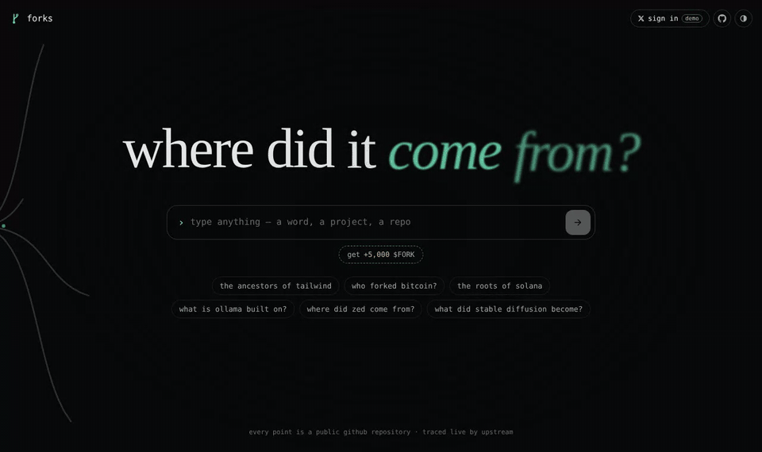
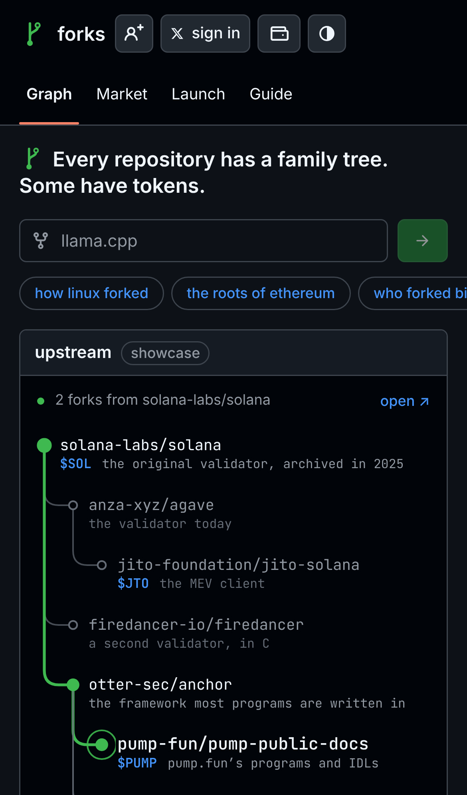
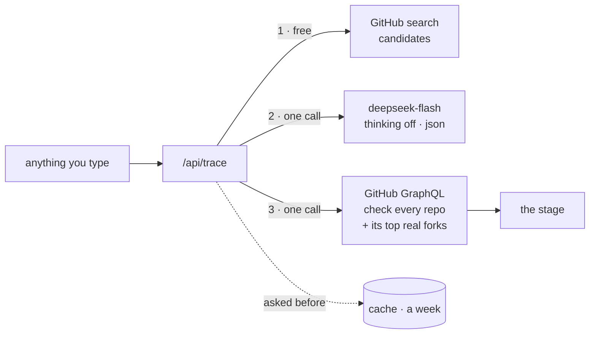
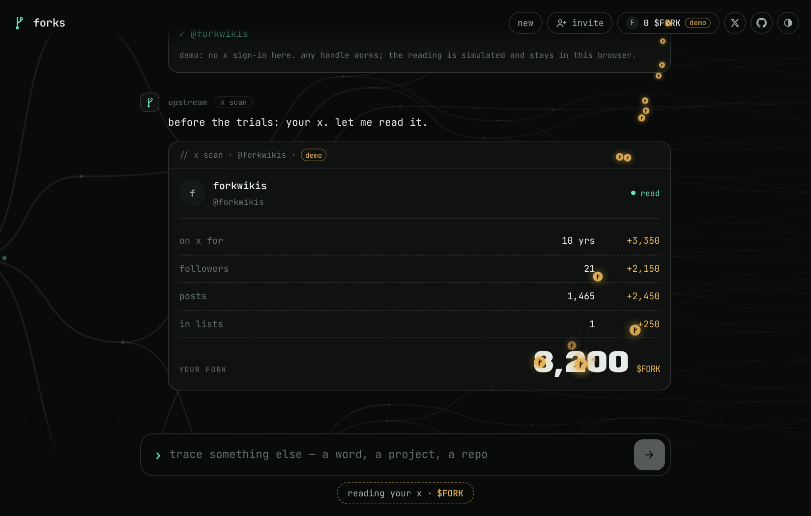
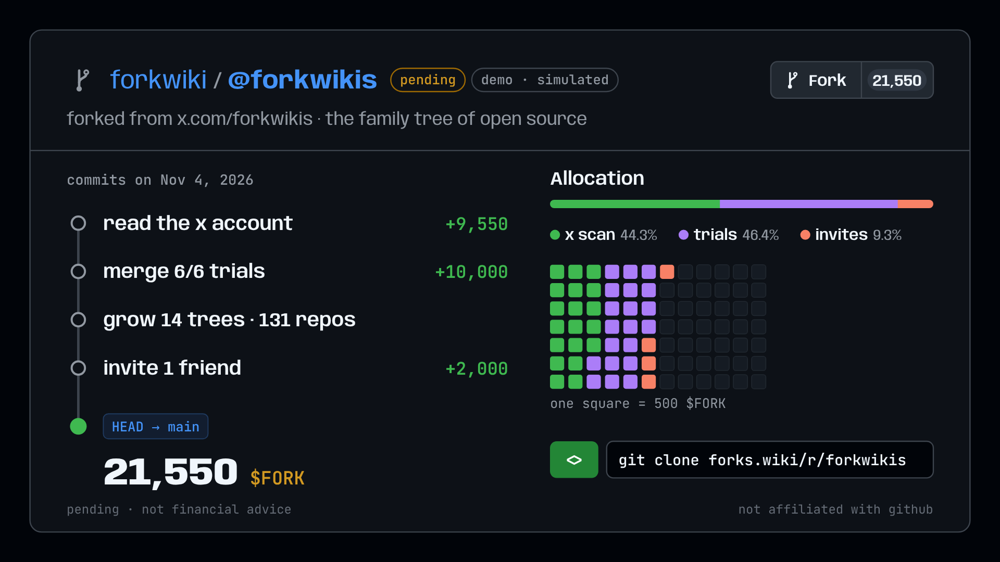

<div align="center">


### Type anything. Watch the GitHub repositories it came from grow.

Every point is a real public repository — a fork, a port, a rewrite, a project built on the one before — with its stars, its year and one tap to GitHub.

[](https://forks.wiki)
[](LICENSE)
[](src)
[](#what-a-question-costs)
[](#fork)
[](https://x.com/forkwikis)

<br>



</div>

<br>

`bitcoin/bitcoin` was forked into `litecoin-project/litecoin`, which was forked into `dogecoin/dogecoin`. `neovim/neovim` forked `vim/vim`. `ollama/ollama` is built on `ggml-org/llama.cpp`. Open source is one family tree, and forks shows you a branch of it from a single question — a word, a project, `owner/name`, a GitHub link, even something that isn't software at all.

<table>
<tr>
<td width="68%"></td>
<td width="32%"></td>
</tr>
<tr>
<td><sub><b>The result.</b> The line from the origin to your answer, the branches around it, every repo with its stars, language, age and how it came from its parent. Folded into one line until you open it.</sub></td>
<td><sub><b>On a phone</b> the tree grows top to bottom, one row per repository.</sub></td>
</tr>
</table>

## How a question becomes a tree



1. **Candidates.** The server searches GitHub for what you typed.
2. **One model call.** `deepseek-flash`, thinking off, answers in compact json: 8–14 repositories from the origin to your answer, with the interesting branches — famous forks, ports, rewrites, successors.
3. **GitHub checks it.** One GraphQL call looks up every repository: what doesn't exist is dropped, duplicates merged, renamed repos get their current name, GitHub's own forks are marked, the origin's real parent is added above it, and notable real forks (≥ 100★) are hung on for free — up to 16 points.
4. **The stage grows it.** Probes while it looks, then the line point by point, side branches as it passes, the answer ringed. Tap any point for its card: GitHub, its forks, the network graph, *trace from here*.

Stars, years, avatars and links come from GitHub, never from the model.

## What a question costs

| | |
|---|---|
| A new question | one `deepseek-flash` call · ~700 tokens in (mostly the same brief, billed at the cache-hit rate) · ~250 out · **a fraction of a cent** |
| The same question again | **free** — answered from the CDN for a week |
| GitHub | free with a token · one search + one GraphQL call per new question |
| Abuse | new traces limited per IP (`FORKS_TRACES_PER_MIN`, default 8); DeepSeek is prepaid, so the balance is the cap |

## Run it

```bash
git clone https://github.com/forkwiki/fork.git && cd fork
GITHUB_TOKEN=… FORKS_LLM_KEY=sk-… npm start   # http://127.0.0.1:5173
```

No build step. `npm start` serves the page and runs every function in `netlify/functions` the way Netlify routes them. Only the coin launcher has dependencies (pump.fun's SDK and Solana's libraries): `npm install` once for it; without it everything else still runs.

## Deploy

The page needs its functions, so deploy with the Netlify CLI or from Git — **not** by dragging a zip into Netlify (that uploads the page without the functions).

```bash
npm install                   # the launch function's libraries, bundled from node_modules
npx netlify-cli login
npx netlify-cli link          # once: pick the site
npx netlify-cli deploy --prod
```

Set the environment variables in Netlify first, then deploy:

| Variable | |
|---|---|
| `FORKS_LLM_KEY` | DeepSeek API key (any OpenAI-compatible API works with `FORKS_LLM_URL` / `FORKS_LLM_MODEL`) |
| `GITHUB_TOKEN` | fine-grained token, public repositories read-only |
| `X_CLIENT_ID`, `X_CLIENT_SECRET`, `SESSION_SECRET`, `SUPABASE_URL`, `SUPABASE_SERVICE_ROLE_KEY`, `SITE_URL` | only for `/freeforks` |
| `SOLANA_RPC_URL` (+ `launch.treasury` in `src/config.js`) | only for coins on repositories |

`GET /api/health` lists whatever is still missing. Step by step, in Russian: **[SETUP.ru.md](SETUP.ru.md)**.

## $FORK

The **get +10,000 $FORK** button, or `/freeforks`:

1. **Sign in with X.** upstream reads the account first — how long it has been on X, followers, posts, lists, verified — and forks it a one-time pending allocation. The page plays the reading back line by line, then the tokens fly up into the header.
2. **Six trials**, one at a time, 10,000 together: follow, like, retweet, comment (each counted by the server five seconds after its link opens), **ask upstream anything** (counted when your tree grows), and **quote the post with your fork card** (counted by the link to your quote: your handle, a post newer than your account, never counted twice).
3. **Your fork**: a card drawn like a repository page — the commits that made your allocation, where it came from, your invite link as a clone URL. Copy it as a picture, quote on X, save it; then the Solana wallet.

**Invite**: `forks.wiki/r/<handle>`. +2,000 $FORK, pending, for every friend who signs in through your link and finishes three trials.

<table>
<tr>
<td width="50%"></td>
<td width="50%"></td>
</tr>
</table>

Allocations are **pending**, never a balance. The X account and the post live in `src/config.js`; the amounts in the database — `tasks.reward` for the trials, `scan_lines()` and the `scan.*` / `ref.*` knobs in `app_config`. Follow along: [@forkwikis](https://x.com/forkwikis).

## Coins on repositories

Every repository can have one coin, launched on [pump.fun](https://pump.fun) from forks.wiki by anyone with a Solana wallet: `/launch owner/name`, **launch a coin** on any point of a tree, or the chip under a tree. Coins show up on the trees as **$TICKER** next to their repositories; `/coins` lists the newest.

The coin's **creator fees are split once, for good**, between the people behind the code and forks:

| | | |
|---|---|---|
| the owner | 70% | a person's GitHub account; an organization's part goes to its top 5 people |
| top contributors | 5% | the next two people by commits |
| up the line | 10% · 3% · 2% | the owners of the repo it forked from, and the two above — GitHub's fork record first, upstream's traced line after |
| forks | 10% | forks' wallet |

People claim on pump.fun by signing in with GitHub; nobody has to sign up first. Bots and organizations get nothing (pump.fun can't pay an organization). The server decides the split from GitHub and the line; the page never sends it.

The launch is one Jito bundle of up to three transactions — GitHub fee accounts, `create_v2` + the fee-sharing config, then `update_fee_shares_v2`, which revokes the admin — so a coin never exists without its locked split. The server holds no wallet: the launcher's wallet signs and pays, the fresh mint key co-signs after it, and every byte is checked against what the server built. A coin is listed only after the server reads that split back from the chain. Not made or endorsed by the repositories' authors; not financial advice. Owners can ask to be left out (`launch_blocklist`).

## Inside

```
index.html               the page: tokens, layout, every style
src/
  prompt.js              upstream's brief and its json — shared by the server and the Claude artifact
  brain.js               routing, which brain the page has, the GitHub-only fallback
  stage.js               the growing tree
  app.js                 input, results, the repository list, cards, full view
  field.js               the living canopy behind everything
  quest.js · config.js   /freeforks, /invite and every public setting
  card.js                your fork as a picture: drawn on a canvas, copied, quoted
  launch.js · wallet.js  coins on repositories: the split, the logo, the launch; Solana wallets (Wallet Standard)
netlify/
  functions/trace.mjs    one request → one answer: candidates, one model call, the check, the cache
  functions/repos.mjs    GitHub for the fallback
  functions/auth-*.mjs · api.mjs    sign in with X (and who invited you), the trials
  lib/github.mjs · lineage.mjs      GitHub GraphQL and search; proposal → tree of real repos
  functions/launch.mjs   the plan, the bundle, the status, the coins on a tree
  lib/split.mjs · chain.mjs         who gets the fees; pump.fun transactions, Jito, reading them back
supabase/migrations/     the database, closed to anon: 0001 → 0002 (scan) → 0003 (invites, six trials) → 0004 (coins)
fonts/                   Anybody and JetBrains Mono, self-hosted (OFL)
```

More: [docs/UPSTREAM.md](docs/UPSTREAM.md) · [docs/DESIGN_SYSTEM.md](docs/DESIGN_SYSTEM.md) · [docs/DECISIONS.md](docs/DECISIONS.md) · [CHANGELOG.md](CHANGELOG.md)

## License

[MIT](LICENSE). Repository data comes from GitHub's API; forks links to every repository it shows.

<div align="center"><br><br><sub><i>everything forks from something.</i></sub></div>
